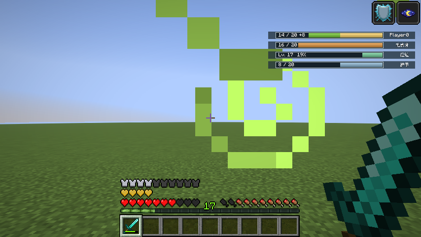
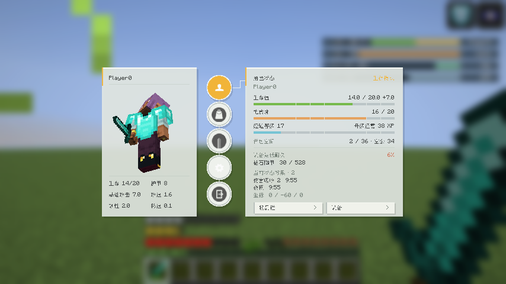

# SAO UI for Fabric

SAO 风格的 Minecraft 界面模组。同一个 JAR 同时支持 **Minecraft 26.2 / 26.3**，无需选择不同构建。

## 最新版本：0.22.0

[下载统一 JAR](https://github.com/CongH174/Minecraft-26.2-26.3-SAO-ui-for-Fabric/releases/download/v0.22.0/sao-ui-0.22.0%2Bmc26.2-26.3.jar) · [Release 与全部下载](https://github.com/CongH174/Minecraft-26.2-26.3-SAO-ui-for-Fabric/releases/tag/v0.22.0) · [使用说明](SAO-UI-0.22.0-使用说明.md)

- HUD 新增右侧开关：镜像图形与填充，文字正常阅读；默认位置避开原版状态效果图标，自定义位置优先。
- 血条样式下拉菜单：SAO 切角、纯矩形，可继续扩展样式。
- 角色页显示实时生命/吸收、饱食度、经验与升级所需 XP、背包空位、装备最低耐久、状态效果及坐标。
- 修复附魔物品原文说明开关的状态显示。
- 界面设置首行直达方块/背包可视化布局；原方块编辑器入口移近表单标题。
- 所有新选项及样式选择均有中英文悬停解释；保留统一草稿保存/取消。

### 安装

Java 25、Fabric Loader 0.19.3+，安装匹配当前游戏版本的 Fabric API：26.2 至少 0.152.1+26.2，26.3 至少 0.164.0+26.3。

移除旧版 SAO UI JAR，将新版放入 mods；保留 config/saoui.json。基础 HUD 与菜单只需客户端安装，容器内额外 2×2 合成需要双方安装并协商支持。AppleSkin / IPN 是可选依赖，不包含在成品中。

### 预览

右侧纯矩形 HUD：

实时角色状态页：

### 验证与源码

同一 SHA256 的成品已在 26.2 / 26.3 实际加载。每版通过 63 项单元测试、15 组功能测试及统一包身份检查。详情见 [验证报告](sao-ui-0.22.0+mc26.2-26.3-validation.txt) 和 [校验和](SHA256SUMS.txt)。

源码按版本压缩存档：[0.22.0 完整源码](sao-ui-0.22.0+mc26.2-26.3-source.zip)。本仓库保留历史成品；成品不包含测试代码或第三方可选模组。

GPL-3.0-only，见 [LICENSE](LICENSE)。非官方 SAO 产品。
