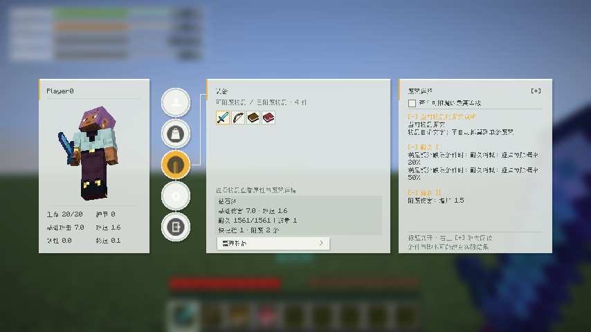
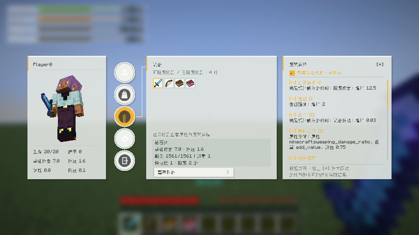
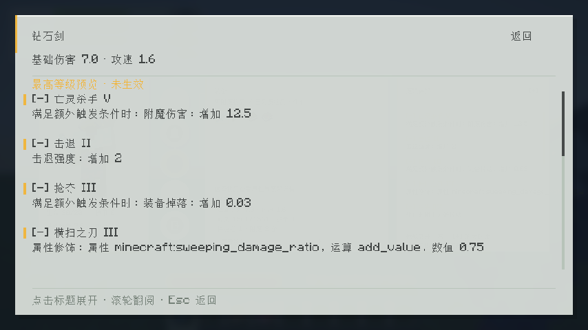
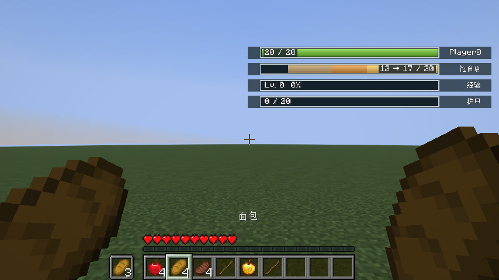

# SAO UI 0.23.1

[返回版本索引](../README.md) · [项目首页](../../README.md)

**当前推荐版本。** [GitHub Release 与全部下载](https://github.com/CongH174/Minecraft-26.2-26.3-SAO-ui-for-Fabric/releases/tag/v0.23.1)。

同一个 JAR 支持 Minecraft **26.2 / 26.3**。本版包含 AppleSkin 手持食物呼吸预览，以及附魔面板的最高等级预览勾选框。

| 文件用途 | 文件 |
| --- | --- |
| 安装包 | [统一 JAR](sao-ui-0.23.1%2Bmc26.2-26.3.jar) |
| 完整源码 | [源码 ZIP](sao-ui-0.23.1%2Bmc26.2-26.3-source.zip) |
| 使用说明 | [使用说明](SAO-UI-0.23.1-使用说明.md) |
| 验证报告 | [双版本报告](sao-ui-0.23.1%2Bmc26.2-26.3-validation.txt) |
| SHA256 | [归档校验和](SHA256SUMS.txt) |

## 附魔模式

不勾选时显示物品实际附魔；勾选后预览此物品适用的每条魔咒及最高等级，标注“未生效”。切换不会修改物品或配置。最高等级来自当前世界的同步定义，也支持适用的数据包魔咒。原版默认参考区块保持移除。

## AppleSkin 手持食物预览

手持可食用食物时，预计恢复的饥饿区间呼吸显示，并提示“当前 → 食用后 / 20”。遵循 AppleSkin 的预览、副手和透明度设置，支持左右及两种血条样式。AppleSkin 为可选依赖，成品不内置。

每版通过 69 项单元测试、17 组完整功能测试及统一包身份检查，并分别验证安装／未安装 AppleSkin 的情况。校验和路径相对此目录。
