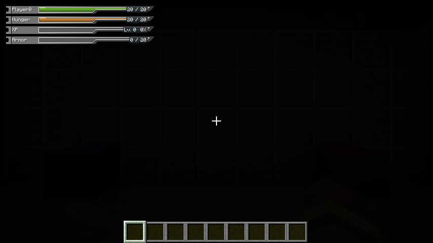
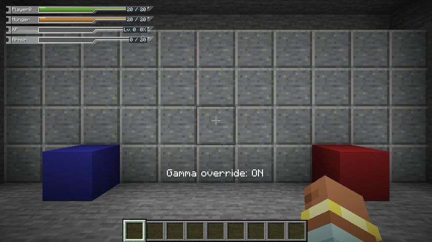
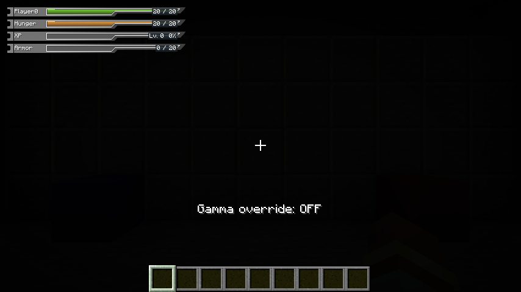

# SAO UI 0.26.0

[返回版本索引](../README.md) · [项目首页](../../README.md)

**当前推荐版本。** [GitHub Release 与全部下载](https://github.com/CongH174/Minecraft-26.2-26.3-SAO-ui-for-Fabric/releases/tag/v0.26.0)。

同一个 JAR 支持 Minecraft **26.2 / 26.3**。

| 文件用途 | 文件 |
| --- | --- |
| 安装包 | [统一 JAR](sao-ui-0.26.0%2Bmc26.2-26.3.jar) |
| 完整源码 | [源码 ZIP](sao-ui-0.26.0%2Bmc26.2-26.3-source.zip) |
| 使用说明 | [伽马复写使用说明](SAO-UI-0.26.0-使用说明.md) |
| 验证报告 | [双版本报告](sao-ui-0.26.0%2Bmc26.2-26.3-validation.txt) |
| SHA256 | [归档校验和](SHA256SUMS.txt) |

## 本次发布（相对 0.23.1）

- **伽马复写**：默认按 **G** 切换，提供类似夜视的暗处高亮，可在原版按键绑定中改键。与 K 菜单独立，默认关闭、退出世界自动关闭；关闭后恢复当前原版亮度。
- **附魔说明**：重写全部 43 种原版魔咒的中英文效果说明，明确适用目标、条件和当前等级数值；服务器修改的效果继续按实际同步数据解释。保留实际附魔／最高等级预览勾选框。
- **装备与角色页面**：扩大说明区域，调整装备目录，保留选择与阅读位置，增加明确的放大阅读按钮；角色页面支持定位低耐久装备与查看完整状态效果。
- **设置与布局**：增加分类内搜索、修改提示和明确的保存／放弃文字，布局入口共享设置草稿；HUD 编辑器可显示辅助参考。
- **菜单动画**：保持原有动画逻辑，继续由现有动画开关和速度滑块控制。

## 伽马复写

在游戏中按 G 开／关，可在“选项 → 控制 → 按键绑定 → SAO UI”中改键。开启后暗处高亮，关闭后继续使用当前原版亮度。不会改写原版亮度设置，也不会添加药水效果或改变服务器光照。

## 验证

同一个 SHA256 的统一 JAR 已在 Minecraft 26.2 和 26.3 实际加载，选中的运行时来源均为 NESTED/saoui。每版通过 77 项单元测试，本次功能测试覆盖伽马开关、改键、真实暗室亮度、关闭恢复、菜单输入隔离、退出世界关闭及统一包身份。验证沿用已完成记录，没有重复运行无关模组兼容测试；自定义光影管线尚未验证。
